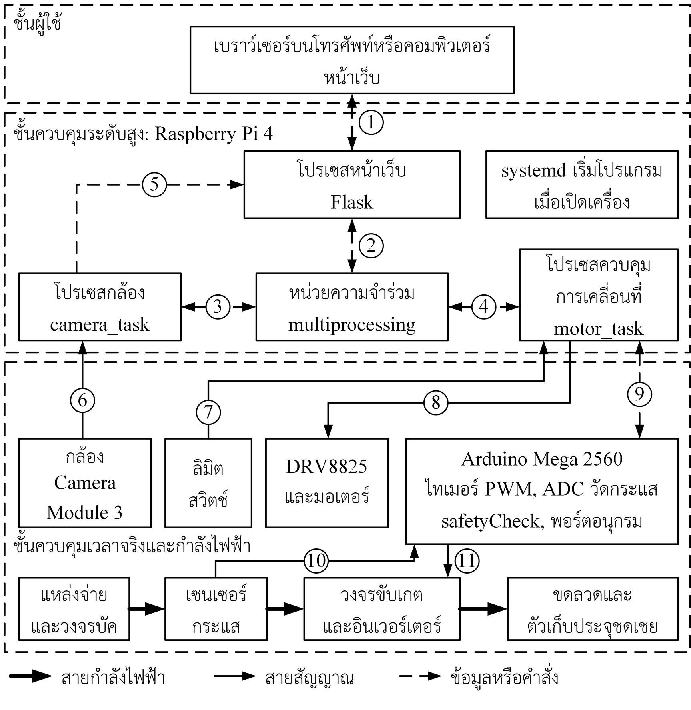
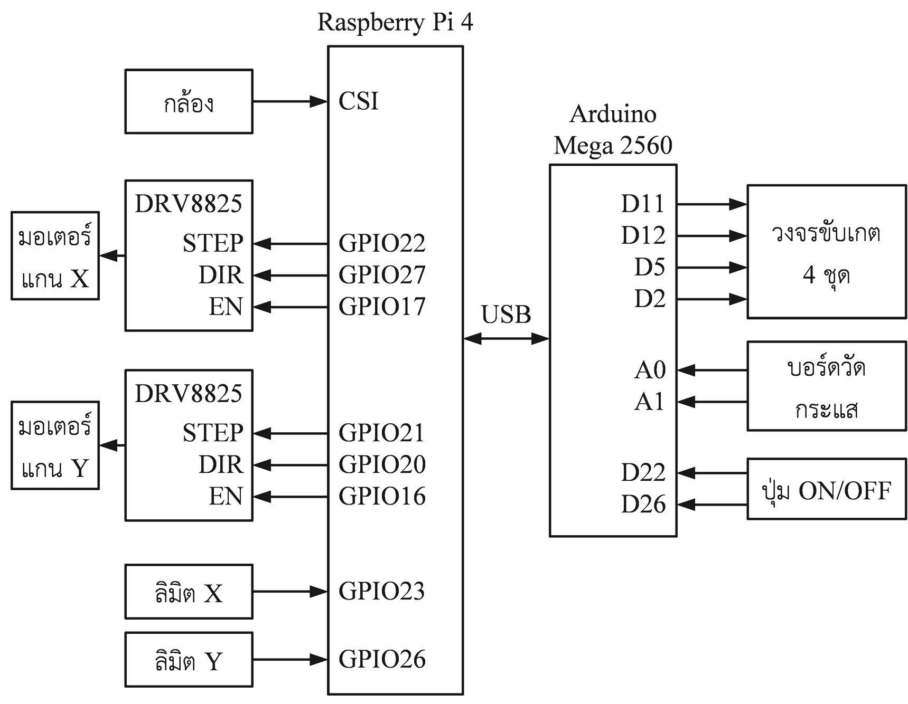

# PnET-CT23: Image Processing Based Auto Alignment Wireless Charger

ระบบชาร์จไร้สายที่จัดตำแหน่งขดลวดอัตโนมัติด้วยการประมวลผลภาพ เป็นส่วนหนึ่งของปริญญานิพนธ์ กล้องตรวจจับเครื่องหมาย ArUco ใต้ยานพาหนะ
แล้วโต๊ะเคลื่อนที่สองแกนพาขดลวดฝั่งส่งไปยังตำแหน่งของขดลวดฝั่งรับ จากนั้นปรับละเอียดด้วยการค้นหาแบบตารางจากกระแสด้านเข้าของอินเวอร์เตอร์



## โครงสร้างของ repository

| โฟลเดอร์ | เนื้อหา |
|---|---|
| `firmware/arduino-mega/` | โปรแกรม Arduino Mega 2560: PWM 85 kHz, วัดกระแส, ป้องกัน, พอร์ตอนุกรม |
| `pi/` | โปรแกรม Raspberry Pi 4 (`maincamera.py` รวมโปรเซสกล้อง โปรเซสเคลื่อนที่ และหน้าเว็บไว้ในไฟล์เดียว) |
| `pi/tools/` | ไฟล์ตั้งค่าบริการ systemd และเครือข่าย Wi-Fi |
| `hardware/pcb/` | แผนผังวงจรและลายวงจรพิมพ์ |
| `hardware/cad/` | แบบจำลองสามมิติ |
| `simulation/` | แบบจำลอง Simulink และผลเปรียบเทียบการตั้งค่า (แบบจำลอง COMSOL อยู่ใน Release เพราะไฟล์เกินขนาดที่เก็บใน repository ได้) |
| `data/` | ข้อมูลดิบของผลการทดลองในบทที่ 4 |
| `docs/` | แผนภาพของระบบ |
| `videos/` | วิดีโอการทำงาน |

## การต่อสาย



Raspberry Pi 4 ใช้ GPIO 22 27 17 กับไดรเวอร์แกน X (STEP DIR EN), GPIO 21 20 16 กับแกน Y, GPIO 23 และ 26 กับลิมิตสวิตช์ และสื่อสารกับ Arduino ผ่าน USB 115,200 bit/s
Arduino ใช้ขา 11 12 5 2 ส่ง PWM, A0 A1 อ่านเซนเซอร์กระแส และ 22 26 รับปุ่ม

## การติดตั้ง

Raspberry Pi 4 (Debian GNU/Linux 13 trixie):

```bash
sudo apt install python3-picamera2 python3-pigpio pigpio python3-opencv python3-flask python3-serial python3-numpy
sudo systemctl enable --now pigpiod
```

รายชื่อไลบรารีอยู่ใน `pi/requirements.txt` เส้นทางในโปรแกรมและไฟล์ service เป็นเส้นทางบนเครื่องต้นแบบ (`/home/notathip/ev_charger`, โฟลเดอร์ `RaspberryPI/`) ต้องปรับให้ตรงกับเครื่องที่ใช้

Arduino Mega 2560: เปิด `firmware/arduino-mega/EV_INVERTER_SERIAL/EV_INVERTER_SERIAL.ino` ด้วย Arduino IDE หรือใช้ PlatformIO ด้วย `platformio.ini`

## วิธีรัน

```bash
sudo python3 pi/maincamera.py
```

เปิด `http://<ที่อยู่ของ Raspberry Pi>` จากโทรศัพท์หรือคอมพิวเตอร์ในเครือข่ายเดียวกัน เครื่องต้นแบบเริ่มโปรแกรมเองด้วย `pi/tools/evcharger.service` ซึ่งตั้ง `EV_PORT=80` จึงเปิดได้ที่ `http://<ที่อยู่ของ Raspberry Pi>`

## พารามิเตอร์ที่ปรับได้

ค่าคงที่อยู่ตอนต้นของ `pi/maincamera.py`: `SPIRAL_START_MM`, `SPIRAL_INCREMENT_MM`, `MAX_LOOPS` (ก้นหอย), `JUMP_PX_PER_MM` (สเกลภาพ), `GRID_SPAN_MM`, `GRID_POINTS` (ค้นหาแบบตาราง), `TRAVEL_X_MM`, `TRAVEL_Y_MM` (ระยะเคลื่อนที่)
ค่าตัดกระแสเกินตั้งได้จากหน้าเว็บในโหมดผู้พัฒนา ค่าเริ่มต้นในเฟิร์มแวร์คือ 5.0 A

## ความปลอดภัย

ระบบนี้จ่ายกระแสสูงเมื่อไม่มีโหลด ห้ามปิดการตัดกระแสเกินขณะทดสอบ และต้องตรวจสอบการต่อวงจรก่อนจ่ายไฟทุกครั้ง

## License

MIT License ดูไฟล์ [LICENSE](LICENSE)
